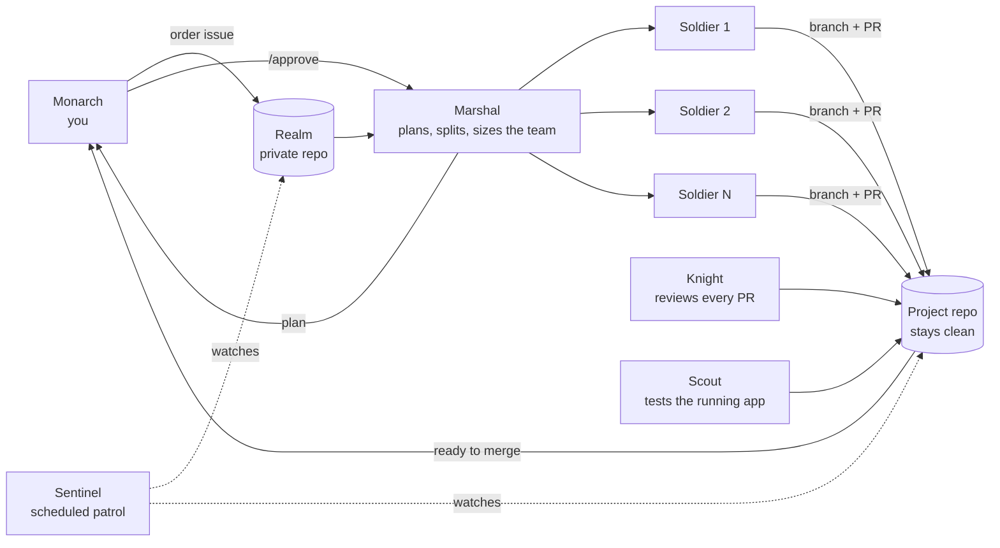

# shadowarmy

One human. An army of AI agents that builds software on GitHub.

shadowarmy turns one private GitHub repository, called **the Realm**, into an AI software team. You are the only human, **the Monarch**. You write an order as a GitHub issue ("in `you/blog`, add an RSS feed" or "new project: a CLI that converts CSV to JSON"), and the army plans it, builds it, reviews it and delivers it as a normal pull request in your project repository. Nothing merges without you.

> **Status: design stage.** These documents describe the agreed design. Nothing is implemented yet. See [the roadmap](docs/roadmap.md) for the build order and [the behavior contract](docs/behavior-contract.md) for the rules the implementation must follow.

## Why it exists

- **Your projects stay clean.** All agent machinery (workflows, prompts, rules, memory) lives in the Realm. A project repository only ever receives ordinary branches and pull requests, exactly like a human teammate's.
- **You own it.** The Realm is a repository on your account. It runs on GitHub Actions with your own Claude credentials. There is no shadowarmy server.
- **The team grows with the work.** One small fix gets one agent. A feature split into six independent tasks gets six agents working in parallel, inside limits you set.
- **Only you have authority.** Plans that matter and every merge wait for you. GitHub branch protection enforces it, not just a prompt.
- **Your PC can be off.** Everything runs in GitHub's cloud. You follow along and approve from the GitHub website or mobile app.

## How it works



## The army

| Role | Plain meaning | Does |
| --- | --- | --- |
| **Monarch** | You, the only human | Orders work, approves plans, merges pull requests, answers questions |
| **Marshal** | Lead agent | Turns an order into a plan, splits it into tasks, decides team size, reports to you |
| **Soldier** | Developer agent | Implements one task in an isolated copy of the project and opens a pull request |
| **Knight** | Reviewer agent | Reviews every pull request against the order and sends findings back for fixes |
| **Scout** | QA agent | Builds and runs the project, tests the change, reports bugs |
| **Sentinel** | Scheduled supervisor | Notices stuck or finished work, dispatches queued tasks, keeps the status report current |
| **Realm** | Control repository | Holds the whole army: workflows, rules, configuration and the order board |

The names are flavor. Labels, configuration keys and status text stay plain so anyone can read them. See [the glossary](docs/glossary.md).

## Planned usage

This is the target experience. It does not work yet.

```sh
npx shadowarmy init          # create your private Realm, labels and secrets
```

1. Open an issue in your Realm with the **Order** form: target repository and task.
2. Add the `arise` label.
3. For bigger orders, the Marshal posts a plan. Reply `/approve`.
4. Pull requests appear in your project repository. Review and merge them there.
5. The Sentinel marks the order done when the pull requests merge.

## Documentation

| Document | Read it for |
| --- | --- |
| [AGENTS.md](AGENTS.md) | Instructions for anyone (human or agent) building shadowarmy |
| [PROJECT_CONTEXT.md](PROJECT_CONTEXT.md) | High-level context, current state, open questions |
| [Behavior contract](docs/behavior-contract.md) | The agreed rules the implementation must follow |
| [Roles](docs/roles.md) | Each agent's inputs, outputs, permissions and failure handling |
| [Configuration](docs/configuration.md) | `shadowarmy.yml`, secrets, labels and issue forms |
| [Security](docs/security.md) | Threat model and required safeguards |
| [Roadmap](docs/roadmap.md) | Milestones with acceptance criteria |
| [Decisions](docs/decisions.md) | Dated decision log |
| [Glossary](docs/glossary.md) | Themed names and their plain meanings |
| [Functional diagrams](functional-diagrams/README.md) | Architecture and one sequence diagram per action |
| [DEVELOPMENT.md](DEVELOPMENT.md) | How to build and test the engine |
| [CONTRIBUTING.md](CONTRIBUTING.md) | How to contribute |
| [firstmate bridge](docs/firstmate-bridge.md) | Planned link with the local firstmate supervisor |
| [Company vision](docs/company-vision.md) | Parked ideas beyond the software team |

## Inspiration and credits

- The supervision model (one human authority, workers in isolated copies, durable records, honest reporting) is inspired by [firstmate](https://github.com/kunchenguid/firstmate) by Kun Chen (MIT).
- The name borrows the general idea of a "shadow army" that grows on command, a common anime and fantasy trope. shadowarmy is not affiliated with or endorsed by any anime, manga, author, publisher or studio, and uses no characters, names, logos or artwork from any of them.

## License

MIT (planned).
