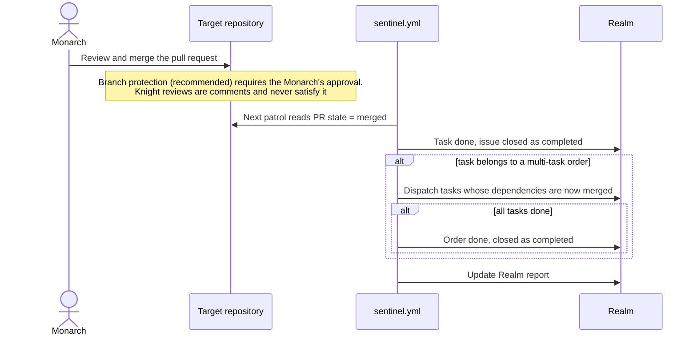

# Merge And Close

Milestone 3. Merging is always the Monarch's act; no engine code path merges.

Task branches are left for the target repository's own branch-deletion setting; the engine does not delete branches.
