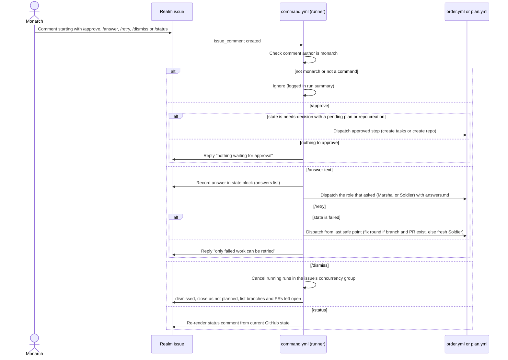

# Monarch Commands

Milestone 3.

Pull request feedback: a Monarch review with "request changes", or a Monarch PR comment starting with `/fix`, is picked up by the Sentinel on its next patrol and starts a fix round with that text as feedback.
