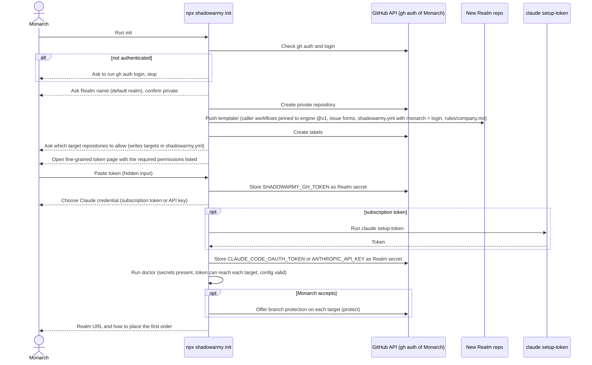

# Set Up A Realm

Milestone 5 (`init` CLI). Until then the same steps are done by hand following [Realm setup](../../docs/realm-setup.md).

Secrets are never printed, logged or written to disk by the CLI.
