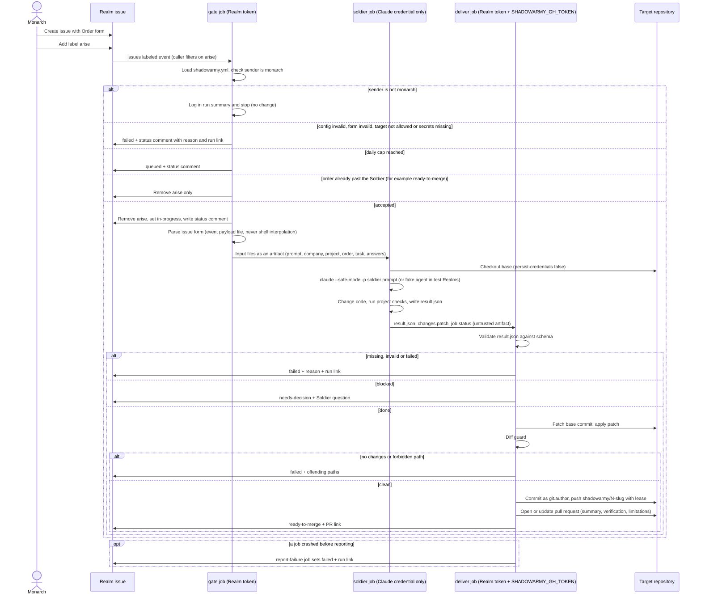

# Single-Task Order

Milestone 1, implemented in `.github/workflows/order.yml` and `src/order/` (without the Knight; the Knight is added in milestone 2, see [review and fix loop](review-and-fix-loop.md)). Each box on the runner side is a separate job on its own runner, so the agent never shares a machine with the GitHub write token.

