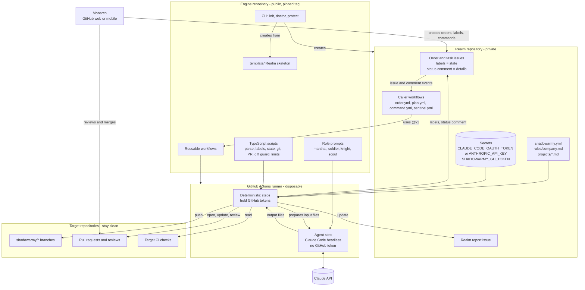
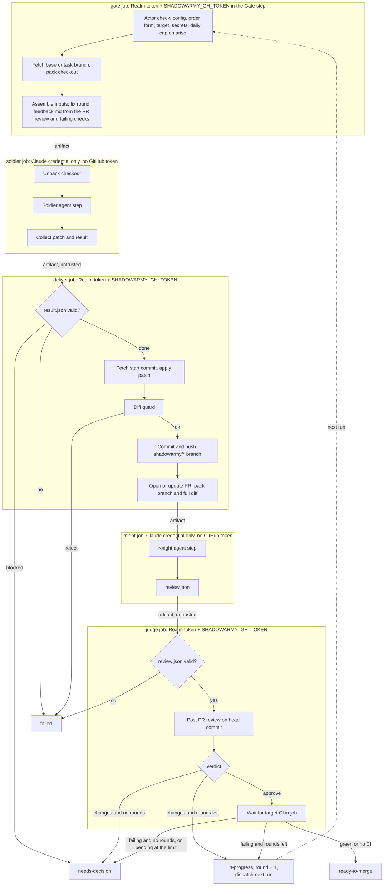

# shadowarmy Architecture

Maintenance note: whenever the architecture, workflows, data model or repository layout changes, update this file in the same change.

Status: agreed design, November 8, 2026, updated November 9, 2026. The parts marked "exists" in the engine layout below are implemented: the milestone 0 modules and the milestone 1 single-task order workflow (Soldier only, no Knight or CI wait yet).

## Summary

- **Engine** (public repository): reusable workflows, TypeScript scripts, role prompts, Realm skeleton, CLI.
- **Realm** (private repository per Monarch): thin caller workflows, configuration, rules, project notes, and the order board as issues.
- **Target repositories**: the Monarch's projects. Receive only `shadowarmy/*` branches, pull requests and pull request reviews.
- **Runtime**: GitHub-hosted Actions runners. Agents are headless Claude Code runs; everything else is deterministic Node 22 TypeScript.
- **State**: labels and one engine-authored status comment per issue. No database.

## Architecture Diagram



## Workflows And Jobs

| Reusable workflow | Triggered by (in the Realm) | Jobs |
| --- | --- | --- |
| `order.yml` | `issues: labeled` with `arise`; engine dispatch for fix rounds (later also `command.yml` and `sentinel.yml`) | `gate` (actor, config, form, target, credentials, daily cap, inputs), `soldier` (agent only), `deliver` (validate, apply, diff guard, push, PR), `knight` (agent only), `judge` (validate and post review, dispatch fix rounds, wait for CI), `report-failure` (safety net) |
| `plan.yml` | dispatch from `order.yml` for multi-task and New project orders | `plan` (Marshal, validate, render, request approval) |
| `command.yml` | `issue_comment: created` | `command` (actor check, parse command, act or dispatch) |
| `sentinel.yml` | `schedule`, `workflow_dispatch` | `patrol` (reconcile, resume, stuck detection, dispatch, report) |

Dispatch between workflows uses `workflow_dispatch` through the Realm's `GITHUB_TOKEN`, with the issue number as input. Every job that touches one issue uses the concurrency group `shadowarmy-<issue>`.

## Jobs Of `order.yml`

Implemented in milestones 1 and 2. One run is one round. Agents run in their own jobs, which are never sent the GitHub write token: the gate job fetches the target and hands the checkout over with the Soldier's inputs, and the deliver job does the same for the Knight ([decisions 23 and 31](../docs/decisions.md)). A fix round is a new run dispatched by the judge ([decision 30](../docs/decisions.md)); see the [review and fix loop](actions/review-and-fix-loop.md).



## Repository Layouts

Engine ("exists" marks what is built; everything else is planned):

```text
shadowarmy/
  .github/workflows/      ci.yml, order.yml (exist); plan.yml, command.yml, sentinel.yml (reusable)
  roles/                  soldier.md, knight.md (exist); marshal.md, scout.md
  scripts/                check-workflow-expressions.ts, lint-shell.sh (dev-only lint helpers), fake-agent.sh (test Realms) (exist)
  src/
    cli/                  order.ts (exists: gate, deliver, judge, fail); init, doctor, protect
    order/                context.ts gate.ts deliver.ts judge.ts fail.ts (exist)
    schemas/              config.ts, state.ts, result.ts, review.ts (exist); plan, scout
    config.ts issueForm.ts labels.ts statusComment.ts names.ts schema.ts (exist)
    github.ts git.ts realmIssue.ts event.ts inputs.ts diffGuard.ts limits.ts prBody.ts soldierResult.ts (exist)
    knightReview.ts ci.ts feedback.ts targetRepo.ts (exist, milestone 2)
    sentinel.ts
  template/               Realm skeleton (exists: order caller, Order form, shadowarmy.yml, rules, projects, README)
  tests/                  unit tests, helpers and fixtures (exist)
  docs/  functional-diagrams/
```

Realm (created by `init`):

```text
realm/
  .github/workflows/      order.yml, command.yml, sentinel.yml (thin callers)
  .github/ISSUE_TEMPLATE/ order.yml, new-project.yml
  shadowarmy.yml
  rules/company.md
  projects/<owner>__<repo>.md
  README.md
```

## Data Model

There is no database. The data model is GitHub objects.

| Object | Where | Written by | Content |
| --- | --- | --- | --- |
| Order issue | Realm | Monarch (body), engine (labels, status comment) | Target, task text, kind label, state label |
| Task issue | Realm | Engine | Task from the plan, link to parent order, state label |
| Status comment | Realm issue | Engine only | Human summary + `<!-- shadowarmy:state {...} -->` |
| Realm report | Realm pinned issue | Sentinel only | Active work, decisions needed, ready PRs, failures, runs used |
| Task branch | Target | Engine push step | `shadowarmy/<issue>-<slug>` |
| Pull request | Target | Engine | Change, verification, limitations |
| Knight review | Target PR | Engine (from `review.json`) | Comment-type review body with findings and a machine block |
| Run artifacts | Actions | Engine | Agent transcripts (redacted), Scout evidence |

State block (version 1):

```json
{
  "version": 1,
  "kind": "task",
  "target": "owner/repo",
  "base": "main",
  "baseSha": "3f1c2a9e8d7b6c5a4f3e2d1c0b9a8f7e6d5c4b3a",
  "branch": "shadowarmy/42-rss-feed",
  "pr": 7,
  "round": 1,
  "runs": [{ "role": "soldier", "runId": 123456789, "conclusion": "success" }],
  "ciWaitStartedAt": null,
  "lastError": null,
  "parent": 41,
  "dependsOn": []
}
```
